<div align="center">

<picture>
  <source media="(prefers-color-scheme: dark)" srcset="public/brand/logo-dark.png">
  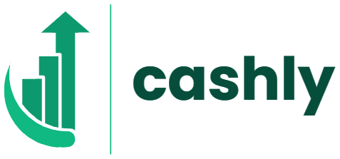
</picture>

### Finanzas personales con inteligencia artificial

Registra tus ingresos y gastos, planifica con presupuestos, metas y deudas, y conversa con un asistente que conoce tus datos reales.


<br>

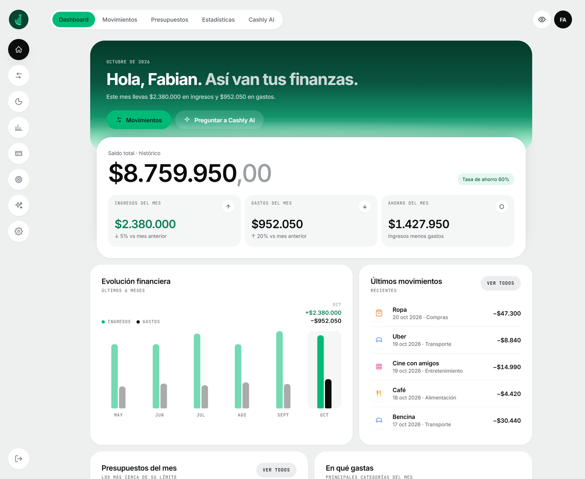

<sub>Las capturas de este documento usan <b>datos de ejemplo</b> de una persona ficticia.</sub>

</div>

---

## ¿Qué es Cashly?

**Cashly** es una aplicación web de finanzas personales pensada para uso individual. Reúne en un solo lugar el registro de movimientos, la planificación (presupuestos, metas de ahorro, deudas y movimientos programados) y el análisis (estadísticas, alertas automáticas y un asistente conversacional con IA), con los datos aislados por usuario y sin exponer claves de servicios externos en el navegador.

- **Moneda y formato chilenos:** pesos (CLP), separador de miles y coma decimal.
- **Rápida de usar:** plantillas, favoritos, registro por chat y movimientos que se generan solos.
- **Privada:** modo privacidad para ocultar los montos y datos protegidos con Row Level Security.
- **Moderna:** diseño responsive, modo oscuro y animaciones suaves.

---

## Funcionalidades

### Dashboard
Saldo total, ingresos, gastos y ahorro del mes con su variación respecto al mes anterior, evolución de los últimos 6 meses, últimos movimientos, presupuestos más cercanos al límite y **alertas automáticas**: gastos inusuales, gastos hormiga y posibles suscripciones.


### Movimientos
Ingresos y gastos con **nombre** y **descripción**, categorías con color e ícono (66 disponibles), **búsqueda y filtros avanzados** (período, rango de fechas, tipo, categoría y montos) y **favoritos** para registrar lo que repites en dos toques. El monto se formatea mientras escribes.

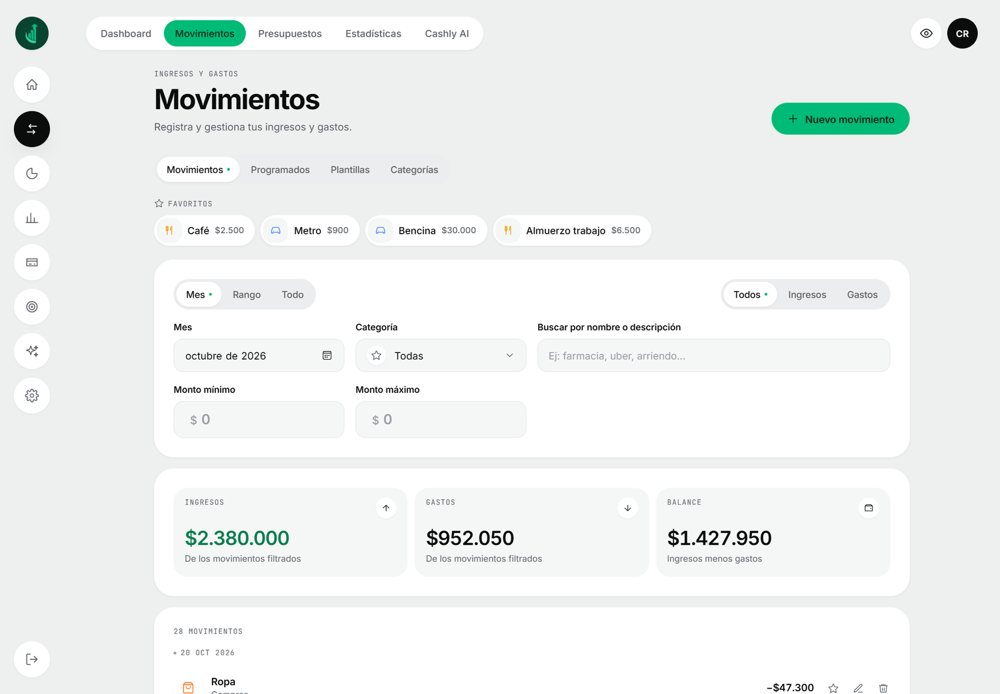

### Movimientos programados
Reglas mensuales, semanales o anuales (por ejemplo, el arriendo el día 1 de cada mes) que generan los movimientos automáticamente, sin duplicados.

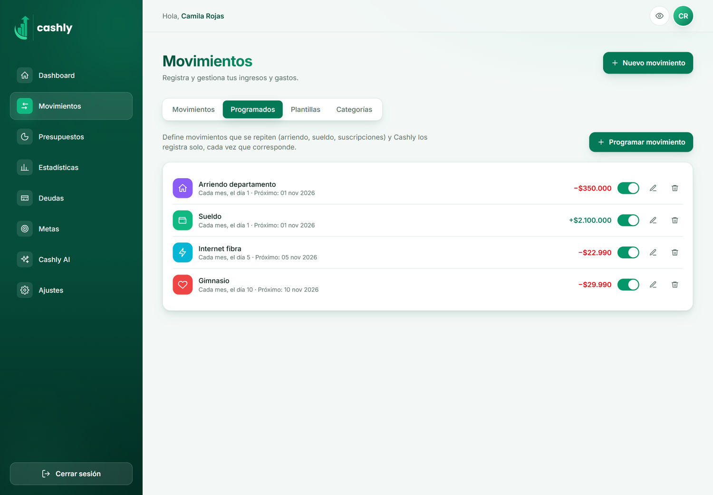

### Presupuestos
Límites por categoría y un presupuesto total por mes, con barras de progreso y tres estados (dentro del presupuesto, cerca del límite y excedido). El **umbral de alerta es configurable por usuario** y se puede copiar el presupuesto del mes anterior.

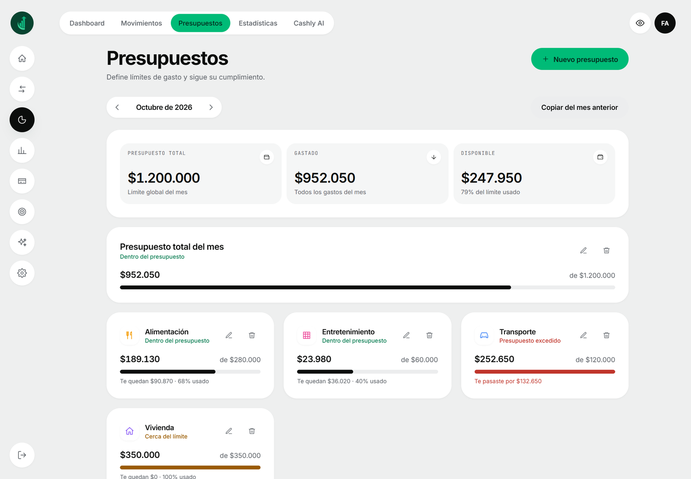

### Estadísticas
Ingresos vs gastos, distribución por categoría, balance acumulado, gasto por día de la semana y ranking de categorías con su variación frente al período anterior. Períodos: mes, 3, 6 y 12 meses, o el año.

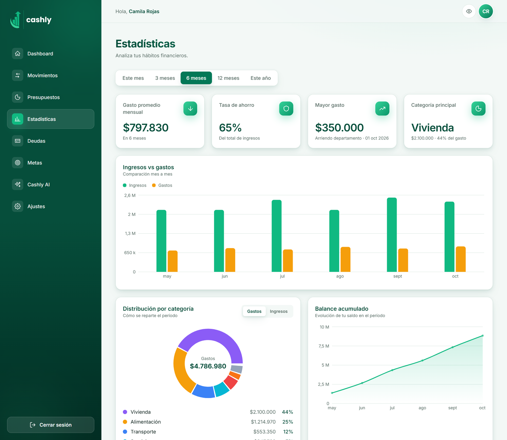

### Metas de ahorro y simulador
Metas con aportes y retiros, historial, **aporte mensual necesario** para llegar a la fecha objetivo y un **simulador de ahorro** que estima cuándo llegarás según tu aporte y una rentabilidad opcional.

<table>
  <tr>
    <td width="50%">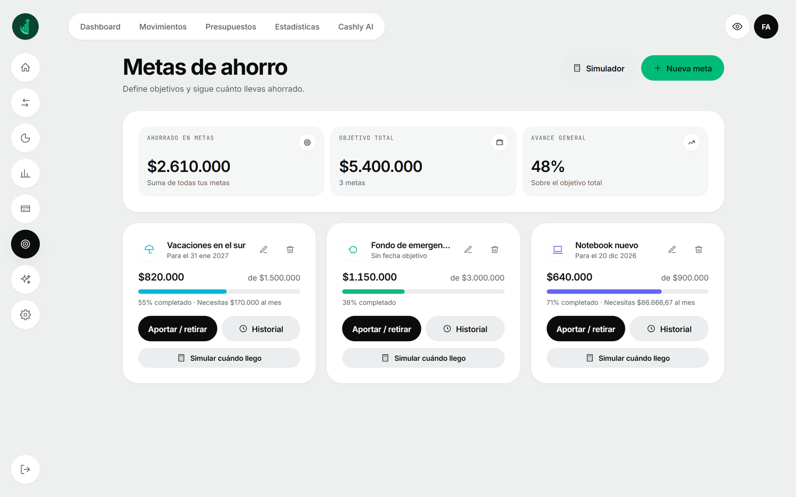</td>
    <td width="50%">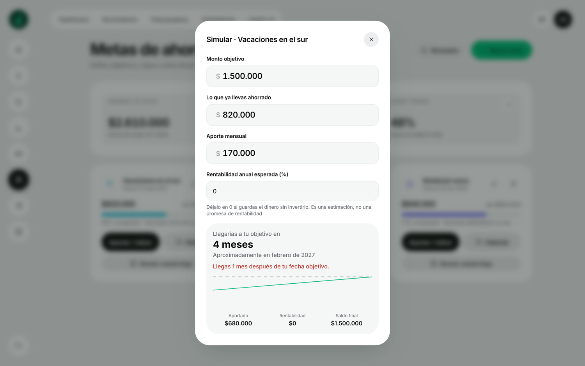</td>
  </tr>
</table>

### Deudas
Registra lo que debes con su vencimiento. Al presionar **Pagar**, Cashly registra el pago (total o parcial) y **genera automáticamente el gasto** en tus movimientos, en una sola operación. También se puede deshacer un pago.

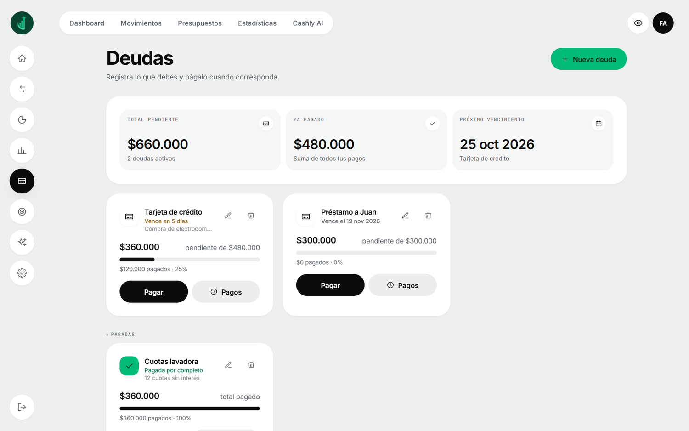

---

## Cashly AI

Un asistente conversacional que responde **solo con tus datos reales**: movimientos, categorías, presupuestos, metas y movimientos programados.

- Conserva el **historial de conversaciones**.
- Muestra cuántos **segundos** tarda en responder.
- **Registra movimientos por chat:** escribes *"Anota un gasto de 12 mil en Uber ayer"* y deja una tarjeta para **confirmar, editar o descartar**. La IA nunca guarda nada por sí sola.

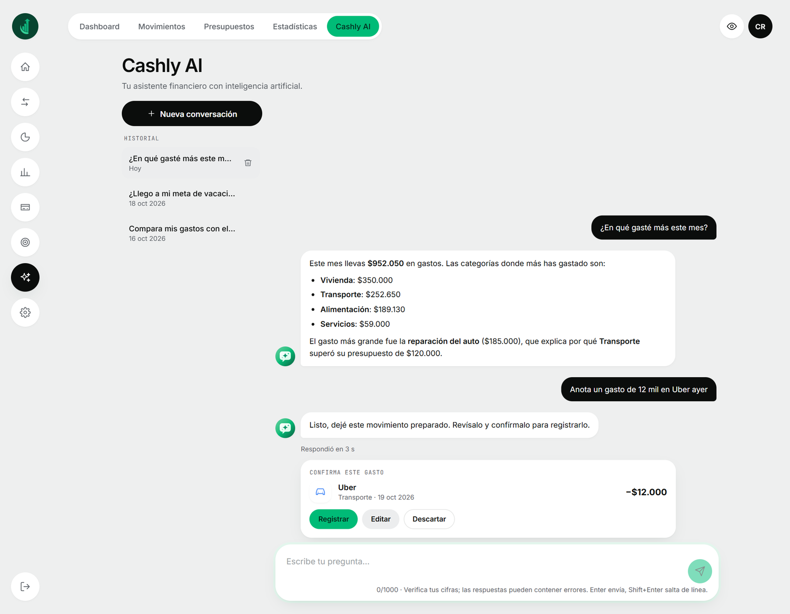

Mientras piensa, muestra el tiempo transcurrido en segundos:

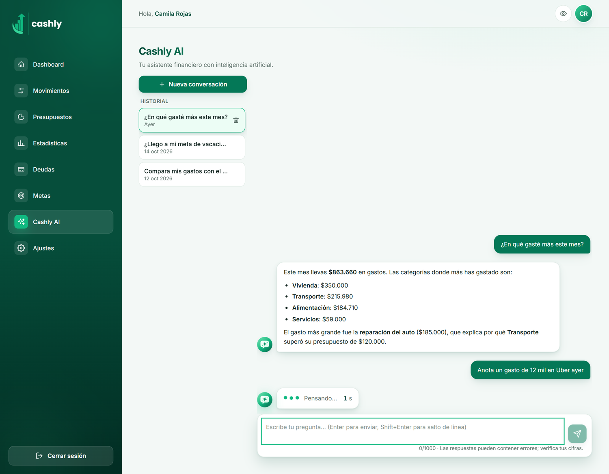

---

## Modo oscuro y modo privacidad

Tema claro y oscuro con textos de alto contraste, y un botón para **ocultar todos los montos** de la pantalla (incluidos tooltips y ejes de gráficos).

<table>
  <tr>
    <td width="50%">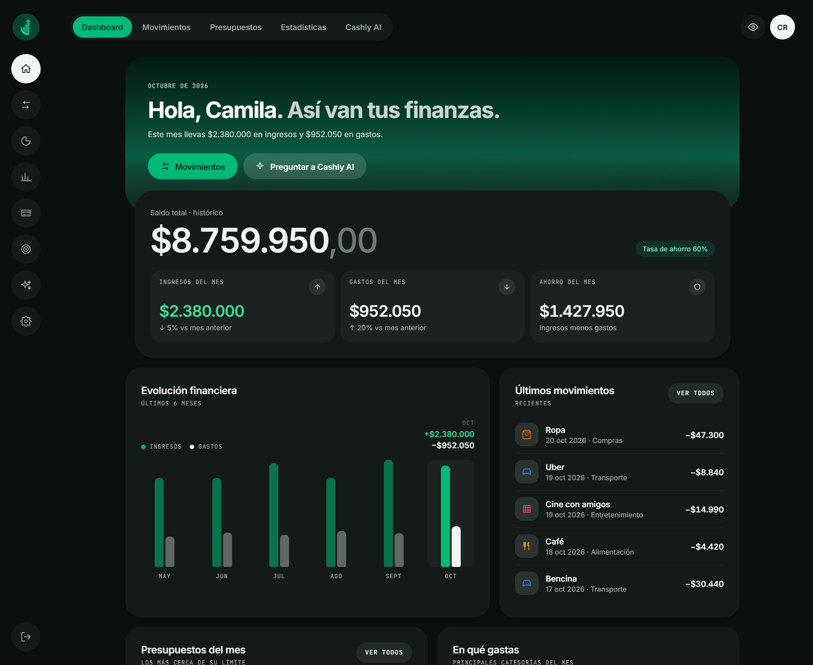</td>
    <td width="50%">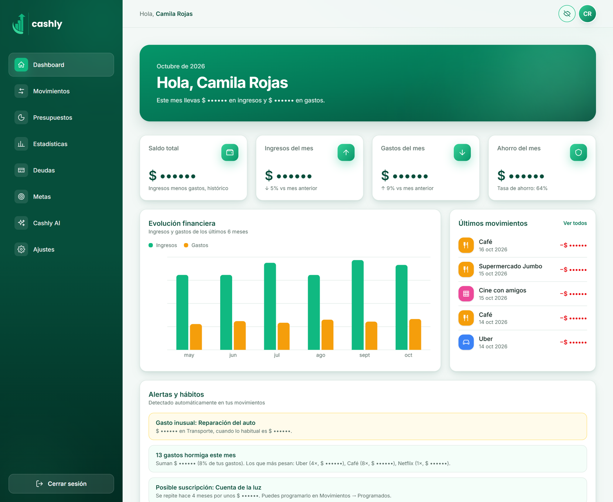</td>
  </tr>
</table>

## Móvil

Diseño responsive con barra de navegación inferior.

<p align="center">
  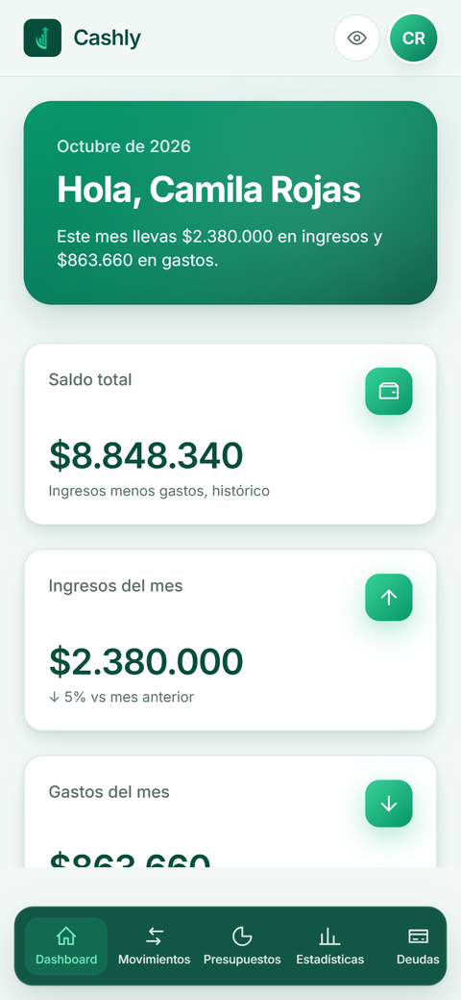
  &nbsp;&nbsp;
  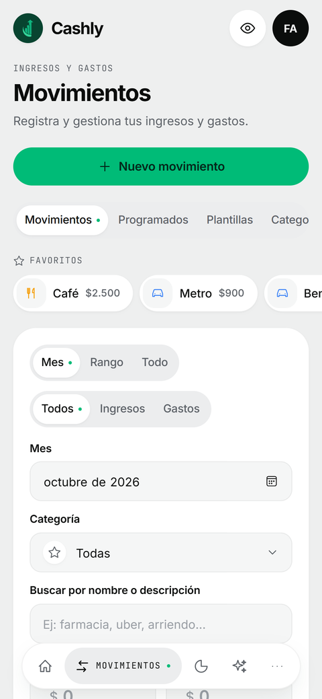
</p>

## Acceso

Inicio de sesión con correo y contraseña. Es una aplicación de uso personal, por lo que los registros nuevos están desactivados.

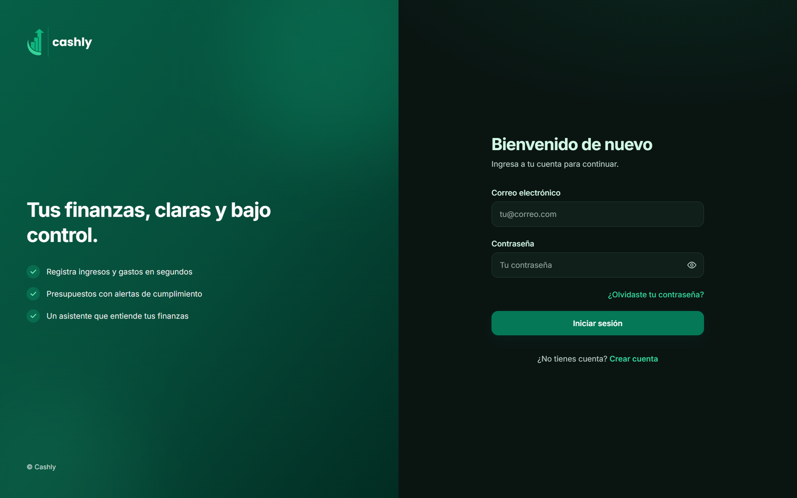

---

## Arquitectura

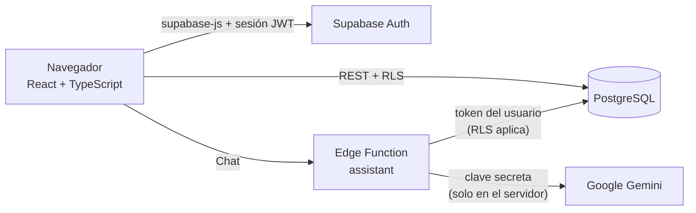

| Capa | Tecnología |
|---|---|
| Interfaz | React 19, TypeScript (modo estricto), Vite, Tailwind CSS 4, React Router 7, Recharts |
| Datos y autenticación | Supabase: Auth, PostgreSQL con RLS, funciones SQL y `pg_cron` |
| Lógica de IA | Supabase Edge Function (Deno) con Google Gemini |
| Calidad | oxlint y TypeScript sin errores |

## Modelo de datos

13 tablas, todas con **Row Level Security** (`auth.uid() = user_id`):

| Grupo | Tablas |
|---|---|
| Núcleo financiero | `categories`, `transactions`, `budgets`, `recurring_transactions`, `transaction_templates` |
| Metas y deudas | `savings_goals`, `goal_contributions`, `debts`, `debt_payments` |
| Cashly AI | `assistant_conversations`, `assistant_messages`, `assistant_usage` |
| Ajustes | `user_settings` |

Las operaciones críticas son funciones SQL atómicas: pagar una deuda crea el pago y el gasto a la vez, y la generación de movimientos programados es idempotente.

## Seguridad

- **RLS en todas las tablas** y rol anónimo sin permisos. Las claves foráneas compuestas `(id, user_id)` impiden vincular datos de otro usuario.
- **Ninguna clave privada en el navegador:** solo la clave pública de Supabase. La clave de Gemini vive como secreto del servidor.
- **La IA solo lee:** la Edge Function valida la sesión, lee con el token del usuario y no escribe datos financieros; el registro por chat exige confirmación.
- **Límites y validaciones:** 30 mensajes por hora, tamaño máximo de solicitud y propuestas validadas en el servidor.
- **Navegador:** sin `innerHTML` ni `eval`, redirecciones internas validadas y CSP en la build de producción.
- **Auditoría y pruebas:** pruebas de acceso anónimo contra la API, revisión del Security Advisor de Supabase y un script de aislamiento entre usuarios en [`supabase/tests/rls_isolation.sql`](supabase/tests/rls_isolation.sql). Más detalle en [SECURITY.md](SECURITY.md).

## Estructura del proyecto

```
src/
  pages/               una página por ruta (Dashboard, Movimientos, Presupuestos, ...)
  components/
    ui/                componentes reutilizables (Card, Modal, Select, MoneyField, ...)
    features/          formularios, gestores y gráficos de cada módulo
    layout/            barra lateral, barra superior y guardas de ruta
  lib/                 cliente de Supabase, capa de datos, cálculos y utilidades
  hooks/               hooks compartidos
supabase/
  migrations/          migraciones SQL (0001 a 0010)
  functions/assistant/ Edge Function de Cashly AI
  tests/               prueba de aislamiento entre usuarios
public/brand/          logotipo e ícono
assets/readme/         capturas de este documento
```

## Desarrollo local

```bash
npm install
npm run dev      # servidor de desarrollo
npm run lint     # análisis estático
npm run build    # comprobación de tipos y build
```

La aplicación lee la URL y la clave pública de Supabase desde un archivo `.env` (ver [`.env.example`](.env.example)).

---

<div align="center">

<picture>
  <source media="(prefers-color-scheme: dark)" srcset="public/brand/icon.png">
  
</picture>

<sub>Hecho por <a href="https://github.com/fabiandresss">@fabiandresss</a></sub>

</div>
